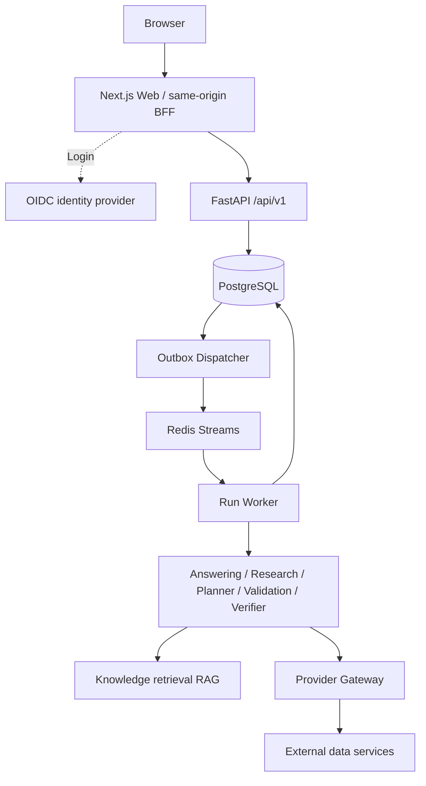

# RoutePilot

**Turn travel ideas into grounded, adaptable itineraries.**

[中文](README.md) · English

RoutePilot is an open-source travel assistant. Start with a question, then refine your destination, dates, travel party, budget and preferences into a plan with daily activities, places, costs, evidence and risk notes. Plans are stored as structured versions that you can revise, revisit and share through minimized, read-only links.

The project is evolving toward global, multilingual travel planning. **The current V1 experience focuses on Chinese-language use, knowledge about China and AMap data.** International destinations, global data and the independent AgentOps platform are tracked in the [roadmap](#roadmap). This English README does not imply that the application or all linked guides are translated.

[Quick start](#quick-start) · [Data integrations](#data-and-third-party-services) · [Architecture](#architecture) · [AgentOps](#independent-agentops) · [Documentation](docs/README.md)

## What you can do

| Your goal | How RoutePilot helps |
| --- | --- |
| Explore a destination, accommodation area or travel pace | Ask directly and get an evidence-based answer without completing a planning form first |
| Build a day-by-day plan | Confirm dates, travelers, budget and preferences; generate and validate a candidate itinerary |
| Understand the recommendation | Inspect sources, freshness, constraint conflicts and items that need verification |
| Adjust an existing plan | Replan from the current published version while preserving history and rejecting stale updates |
| Discuss a plan with others | Create a minimized, read-only share link that can be rotated or revoked |

For the current Chinese-language experience, try:

> 带父母去北京 4 天，少走路，重点看历史文化，住哪里比较方便？

This asks where to stay for a four-day Beijing trip with parents, less walking and a focus on history and culture.

The flow is **ask → read the evidence → convert to an itinerary → confirm constraints → review the plan and risks → adjust or share**. See the [user guide](docs/product/user-guide.md).

Live hotel, flight, train and attraction inventory or booking are not integrated. Routes and costs may include estimates; inspect their sources and limitations. A budget summary is not a final quote for the entire trip.

## Quick start

### 1. Get the project

The complete local stack requires Git, Docker Engine and Docker Compose v2. Python 3.13, Node.js 24 and npm are needed only for development and tests on your machine.

Delivery note (2026-09-18): the default branch still has database-image and Web-dependency issues, tracked in [#84](https://github.com/tiammomo/RoutePilot/issues/84) and [#85](https://github.com/tiammomo/RoutePilot/issues/85). The commands below describe the standard startup flow; the initial image build may fail until the database-image fix is integrated.

```bash
git clone https://github.com/tiammomo/RoutePilot.git
cd RoutePilot
cp deploy/compose/v1.env.example deploy/compose/.env.v1.local
chmod 600 deploy/compose/.env.v1.local
```

### 2. Configure the local environment

Edit `deploy/compose/.env.v1.local`. Give each of these eight required settings an independently generated random value:

```text
ROUTEPILOT_POSTGRES_ADMIN_PASSWORD
ROUTEPILOT_MIGRATION_DB_PASSWORD
ROUTEPILOT_API_DB_PASSWORD
ROUTEPILOT_WORKER_DB_PASSWORD
ROUTEPILOT_OUTBOX_DB_PASSWORD
ROUTEPILOT_REDIS_PASSWORD
ROUTEPILOT_V1_DEV_BFF_SECRET
ROUTEPILOT_SHARE_PEPPER
```

Run `openssl rand -hex 32` separately for each value. The local file is ignored by Git; Compose rejects empty required values.

AMap, model and embedding credentials can initially remain empty, with the limitations described under [data integrations](#data-and-third-party-services). Local Compose uses development identity. For staging or production, configure OIDC and production authentication using the [platform manual](docs/operations/v1-platform.md).

### 3. Start and check the services

```bash
docker compose --env-file deploy/compose/.env.v1.local \
  --file deploy/compose/v1.yaml config --quiet
docker compose --env-file deploy/compose/.env.v1.local \
  --file deploy/compose/v1.yaml up --build --detach
docker compose --env-file deploy/compose/.env.v1.local \
  --file deploy/compose/v1.yaml ps
curl --fail http://127.0.0.1:38083/api/ready
```

Compose prepares PostgreSQL and Redis, runs Alembic migrations and database grants, then starts the API, Worker, Outbox Dispatcher and Web. The `migration` service is a one-shot task; exiting successfully is expected.

| Entry point | Default URL |
| --- | --- |
| Travel workspace | <http://127.0.0.1:33003> |
| API documentation | <http://127.0.0.1:38083/docs> |
| Liveness | <http://127.0.0.1:38083/api/live> |
| Dependency readiness | <http://127.0.0.1:38083/api/ready> |

Consult [troubleshooting](docs/operations/troubleshooting.md) if startup fails, and check whether your branch includes the delivery fixes above.

### 4. Plan your first trip

Open the workspace and ask the Beijing question above. Read the answer and evidence, choose “转成行程” (convert to an itinerary), confirm dates, travelers, currency and budget, then inspect and adjust the daily plan.

**A new database has no published knowledge by default.** An administrator must explicitly publish the included Chinese knowledge bundle and verify retrieval using the [knowledge deployment guide](docs/operations/knowledge-base-maintenance.md). Unpublished knowledge, missing providers or insufficient sources can result in an evidence-gap message. Running services and having enough travel data are separate requirements.

## Data and third-party services

Models organize answers; knowledge retrieval and providers supply evidence. This branch includes:

| Data or service | Current use | Configuration and fallback |
| --- | --- | --- |
| AMap Web Services | Geocoding, POIs, route matrices, opening hours and weather for China | Set server-only `ROUTEPILOT_AMAP_WEB_KEY`; without it, the corresponding live facts are unavailable |
| Bundled Chinese knowledge | Travel decision methods and planning knowledge for an initial 12 provincial-level regions in China | Requires explicit administrator publication; excludes live prices, schedules, weather and inventory |
| DeepSeek model adapter | Bounded research directives and answers grounded in retrieved evidence | Set `ROUTEPILOT_LLM_API_KEY`; otherwise use deterministic evidence summaries |
| Optional embedding service | Semantic retrieval with PostgreSQL/pgvector | Configure `ROUTEPILOT_EMBEDDING_*`; the current index requires 384 dimensions; lexical retrieval remains available without it |
| OIDC identity provider | Staging/production login and server-side identity verification | Follow the platform manual; local Compose has a separate development identity path |

See the [Compose environment template](deploy/compose/v1.env.example) for complete model and embedding settings. The model adapter enables only the reviewed model profile in code; it is not a general-purpose adapter for arbitrary models.

For AMap, obtain a **Web Service** key, set it in the ignored local environment file, and recreate the services that read it:

```bash
docker compose --env-file deploy/compose/.env.v1.local \
  --file deploy/compose/v1.yaml up --build --detach api run-worker
curl --fail http://127.0.0.1:33003/api/v1/providers/capabilities
```

This request uses the default local development identity. Staging and production require authentication. The capability endpoint reports configuration and capability metadata; **it does not verify upstream connectivity, quota or data coverage**.

Live-fact access goes through the [Provider Gateway](agent/travel_agent/providers/README.md), preserving provenance and freshness while enforcing deadlines, retries, caching and explicit fallbacks. Keep API keys in server configuration or a secret manager, never in `NEXT_PUBLIC_*` variables. Start with the [provider extension guide](docs/development/provider-extension.md) when adding a source.

## Architecture



| Layer | Technology and responsibility |
| --- | --- |
| User experience | Next.js 16, React 19, TypeScript; workspace and same-origin BFF |
| Product control plane | FastAPI, Pydantic v2; trips, runs, versions, members, sharing and public events |
| Agent execution | A2A SDK 1.x, Runtime V2; answering, research, planning, deterministic validation and semantic verification |
| Data and delivery | PostgreSQL 17, PostGIS, pgvector, Redis Streams, transactional outbox |
| Shared contracts | JSON Schema, Python models and generated TypeScript types |

Answers are saved as `TravelAnswer`; published plans are saved as `TripSnapshot`. They are distinct outputs. **Artifact-first** means the UI and subsequent operations consume validated, versioned structured results.

PostgreSQL owns durable state; Redis handles delivery. Product Run, A2A Task and Artifact version have separate lifecycles, and results must pass the control plane's publication checks. Tenant isolation uses server-derived identity, query predicates and RLS. The browser receives structured outputs and allowlisted public event fields. See the [architecture RFC](docs/governance/rfcs/RFC-0003-routepilot-full-rebuild-v1.md).

## Independent AgentOps

AgentOps is intended to become an independent platform reusable across businesses, with RoutePilot as its first consumer. The common platform covers execution observability, durable events, evaluation and cost governance. Travel logic, execution control and publication decisions remain in RoutePilot.

| Layer | Responsibility and current status |
| --- | --- |
| Shared SDK and RoutePilot adapter | Standalone SDK 0.1.0 and application integration are implemented on development branches, not merged into the default branch documented here; see [#80](https://github.com/tiammomo/RoutePilot/issues/80), [#81](https://github.com/tiammomo/RoutePilot/issues/81), [#82](https://github.com/tiammomo/RoutePilot/issues/82) |
| Platform services | Workspace/project/environment identity, durable event ingestion, queries and a console are future work |
| Quality and operations | Evaluation datasets, release evidence, cost budgets and a second real business integration are future work |

**The independent AgentOps platform and the external AgentOps.ai service are separate.** The latter can be an optional telemetry destination; it does not replace the platform. Traces cannot substitute for durable business events, task state or a cost ledger. Current default-branch operational signals are documented in the [observability guide](docs/operations/observability.md).

## Development and verification

From the repository root, with Python 3.13, Node.js 24 and npm:

```bash
python -m venv .venv
.venv/bin/python -m pip install -r requirements-dev.txt
npm ci --prefix apps/web --ignore-scripts
.venv/bin/python scripts/v1_quality_gate.py
```

For documentation-only changes:

```bash
.venv/bin/python scripts/v1_quality_gate.py --only docs
git diff --check
```

The full gate covers contracts, API, A2A, providers, RAG, planning, Web builds and documentation. Real PostgreSQL/Redis integration tests require separately configured stateful services. Passing the default local gate does not prove stateful integration or production deployment. See [local development](docs/development/local-development.md) and the [Web README](apps/web/README.md).

| Directory | Responsibility |
| --- | --- |
| [`apps/web/`](apps/web/README.md) | Travel workspace, BFF and browser login |
| [`backend/moyuan_web/v1/`](backend/moyuan_web/v1/README.md) | Product API, persistence, workers and public events |
| [`agent/travel_agent/`](agent/travel_agent/runtime_v2/README.md) | A2A, travel orchestration, RAG and external data access |
| [`packages/`](packages/), [`schemas/`](schemas/README.md) | Cross-language contracts and generated artifacts |
| [`deploy/`](deploy/) | Migrations, Compose, containers and database grants |
| [`scripts/`](scripts/), [`tests/`](tests/) | Development tools, delivery checks and tests |
| [`docs/`](docs/README.md) | User, developer and operations guides |

Database schema changes use Alembic exclusively. Historical data requires explicit [offline migration](docs/operations/v1-migration-runbook.md). This repository maintains the V1 product line only.

## Roadmap

These are development priorities, **not a list of released features**. Status was checked on 2026-09-18; consult the linked Issues, PRs and your checked-out branch for subsequent changes.

| Direction | Next work |
| --- | --- |
| Reliable delivery | Database-image and dependency fixes, combined CI, deployment and recovery verification: [#84](https://github.com/tiammomo/RoutePilot/issues/84), [#85](https://github.com/tiammomo/RoutePilot/issues/85) |
| Executable itineraries | Timezones, group budgets, distinct visits, persistent constraints and dated opening checks: [#73](https://github.com/tiammomo/RoutePilot/issues/73)–[#78](https://github.com/tiammomo/RoutePilot/issues/78); improve transport timing and budget coverage |
| Global and multilingual planning | International destination and Geoapify geocoding/POI branches: [#77](https://github.com/tiammomo/RoutePilot/issues/77), [#79](https://github.com/tiammomo/RoutePilot/issues/79); expand language support and regional data |
| Independent AgentOps | Deliver the shared SDK, then identity, durable events, queries, evaluation and cost governance: [#82](https://github.com/tiammomo/RoutePilot/issues/82) |
| During the trip | Richer maps, partial replanning, booked-item constraints, export and offline access |

## Documentation and contributing

- **Use the product:** [user guide](docs/product/user-guide.md).
- **Develop:** [contributing](CONTRIBUTING.md), [API and events](docs/development/api-guide.md), [Agent extensions](docs/development/agent-extension.md), [contract extensions](docs/development/artifact-contracts.md).
- **Operate:** [platform manual](docs/operations/v1-platform.md), [knowledge maintenance](docs/operations/knowledge-base-maintenance.md), [backup and recovery](docs/operations/backup-restore.md), [troubleshooting](docs/operations/troubleshooting.md).
- **Browse everything:** [documentation index](docs/README.md), [changelog](CHANGELOG.md).

Read [AGENTS.md](AGENTS.md) before making changes. Report vulnerabilities privately under the [security policy](.github/SECURITY.md).

## License

Project code is licensed under the [MIT License](LICENSE). Third-party data and services remain subject to their respective licenses and terms.
