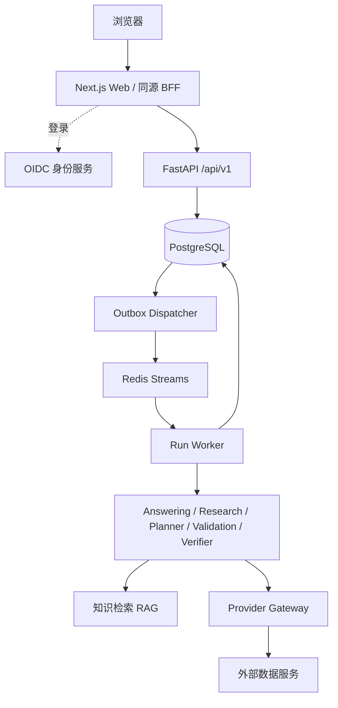

# RoutePilot

**把旅行想法变成有依据、可调整的行程。**

中文 · [English](README.en.md)

RoutePilot 是一个开源旅行助手。你可以先问一个问题，再逐步补充目的地、日期、同行人、预算和偏好，形成包含每日安排、地点、费用、证据与风险提示的旅行方案。行程以结构化版本保存，支持继续调整、查看历史和脱敏分享。

项目面向全球、多语言旅行规划演进。**当前 V1 以中文体验、中国地区知识与高德数据为主**；国际目的地、全球数据和独立 AgentOps 的交付状态见[迭代方向](#迭代方向)。

英文 README 提供项目入口；应用界面与详细指南尚未完成全面翻译。

[快速开始](#快速开始) · [数据接入](#数据与第三方服务) · [架构](#系统架构) · [AgentOps](#独立-agentops) · [文档中心](docs/README.md)

## 能解决什么问题

| 你想做什么 | RoutePilot 的工作方式 |
| --- | --- |
| 先了解目的地、住宿区域或旅行节奏 | 直接提问，获得基于现有证据的回答；无需先填写完整表单 |
| 把想法变成逐日安排 | 确认日期、人数、预算和偏好，生成候选方案并执行规划校验 |
| 知道建议是否可靠 | 查看来源、时效、约束冲突与待核验事项；证据不足时明确提示 |
| 修改已经生成的计划 | 基于正式行程重规划，保留版本，防止过期请求覆盖新方案 |
| 与同行人讨论方案 | 生成脱敏只读分享链接，支持轮换和撤销 |

例如：

> 带父母去北京 4 天，少走路，重点看历史文化，住哪里比较方便？

典型流程是 **提问 → 阅读证据 → 转成行程 → 确认约束 → 查看安排与风险 → 调整或分享**。具体操作见[用户指南](docs/product/user-guide.md)。

当前尚未接入酒店、机票、火车票或门票的实时库存与预订。路线和费用可能包含估算，须结合方案中的来源与提示判断；预算汇总不代表整趟旅行的最终报价。

## 快速开始

### 1. 获取项目

完整本地栈需要 Git、Docker Engine 和 Docker Compose v2。Python 3.13、Node.js 24 和 npm 仅在本机开发与测试时需要。

交付提示（2026-09-18）：默认分支仍有数据库镜像与 Web 依赖问题，修复分别跟踪于 [#84](https://github.com/tiammomo/RoutePilot/issues/84) 和 [#85](https://github.com/tiammomo/RoutePilot/issues/85)。下列命令是标准启动流程；数据库镜像修复合入前，首次构建可能失败。

```bash
git clone https://github.com/tiammomo/RoutePilot.git
cd RoutePilot
cp deploy/compose/v1.env.example deploy/compose/.env.v1.local
chmod 600 deploy/compose/.env.v1.local
```

### 2. 填写本地配置

编辑 `deploy/compose/.env.v1.local`。以下八项是本地启动必填项，每项使用独立随机值：

```text
ROUTEPILOT_POSTGRES_ADMIN_PASSWORD
ROUTEPILOT_MIGRATION_DB_PASSWORD
ROUTEPILOT_API_DB_PASSWORD
ROUTEPILOT_WORKER_DB_PASSWORD
ROUTEPILOT_OUTBOX_DB_PASSWORD
ROUTEPILOT_REDIS_PASSWORD
ROUTEPILOT_V1_DEV_BFF_SECRET
ROUTEPILOT_SHARE_PEPPER
```

可逐次运行 `openssl rand -hex 32` 生成。配置文件已被 Git 忽略；保留空值时 Compose 会拒绝启动。

高德、模型和 embedding 凭据可暂时留空；它们影响可用数据与回答能力，详见[数据接入](#数据与第三方服务)。本地 Compose 使用开发身份；部署到预发或生产时，按[平台手册](docs/operations/v1-platform.md)配置 OIDC 与生产身份边界。

### 3. 启动并检查服务

```bash
docker compose --env-file deploy/compose/.env.v1.local \
  --file deploy/compose/v1.yaml config --quiet
docker compose --env-file deploy/compose/.env.v1.local \
  --file deploy/compose/v1.yaml up --build --detach
docker compose --env-file deploy/compose/.env.v1.local \
  --file deploy/compose/v1.yaml ps
curl --fail http://127.0.0.1:38083/api/ready
```

Compose 会先准备 PostgreSQL、Redis，执行 Alembic migration 和数据库授权，再启动 API、Worker、Outbox Dispatcher 与 Web。`migration` 是一次性任务，成功后退出属于正常状态。

| 入口 | 默认地址 |
| --- | --- |
| 旅行工作台 | <http://127.0.0.1:33003> |
| API 文档 | <http://127.0.0.1:38083/docs> |
| 存活检查 | <http://127.0.0.1:38083/api/live> |
| 依赖就绪检查 | <http://127.0.0.1:38083/api/ready> |

启动失败时先查[故障排查手册](docs/operations/troubleshooting.md)，并确认所用分支是否包含上述交付修复。

### 4. 完成第一次旅行规划

打开工作台，输入上面的北京旅行问题。阅读回答和证据后，选择“转成行程”，确认日期、人数、币种和预算，再查看逐日安排并提出修改。

**新数据库默认没有已发布知识。** 仓库自带的中文知识包需要管理员按[知识库部署流程](docs/operations/knowledge-base-maintenance.md)显式发布并验证检索。知识未发布、Provider 未配置或来源不足时，界面可能提示证据不足；启动成功与拥有充分旅行数据是两个独立条件。

## 数据与第三方服务

模型负责组织答案；知识库与 Provider 提供证据。当前分支的数据接入如下：

| 数据或服务 | 当前用途 | 配置入口与缺省行为 |
| --- | --- | --- |
| 高德 Web 服务 | 中国地区地理编码、POI、路线矩阵、营业时间、天气 | 服务端设置 `ROUTEPILOT_AMAP_WEB_KEY`；未配置时不能提供对应实时事实 |
| 内置中文知识包 | 旅行决策方法，以及首批 12 个中国省级地区的规划知识 | 管理员显式发布；不含实时价格、班次、天气或库存 |
| DeepSeek 模型适配器 | 生成受约束的检索指令，基于已检索证据组织回答 | 设置 `ROUTEPILOT_LLM_API_KEY`；未配置时使用确定性证据摘要 |
| 可选 embedding 服务 | 配合 PostgreSQL/pgvector 做语义检索 | 配置 `ROUTEPILOT_EMBEDDING_*`；当前索引要求 384 维，未配置时保留词法检索 |
| OIDC 身份服务 | 预发与生产登录、服务端身份校验 | 按平台手册配置；本地 Compose 提供独立开发身份路径 |

模型和 embedding 的完整参数以 [Compose 配置模板](deploy/compose/v1.env.example)为准；当前模型适配器只启用代码中已审核的模型配置，并非任意模型的通用接入入口。

接入高德时，申请 **Web 服务**类型的 Key，填入被忽略的本地 env 文件，然后重建读取配置的服务：

```bash
docker compose --env-file deploy/compose/.env.v1.local \
  --file deploy/compose/v1.yaml up --build --detach api run-worker
curl --fail http://127.0.0.1:33003/api/v1/providers/capabilities
```

以上查询适用于默认本地开发身份。预发与生产需要经过身份认证；能力接口只报告配置与能力元数据，**不代表上游连通性、额度或数据覆盖已经验证**。

数据接入统一经过 [Provider Gateway](agent/travel_agent/providers/README.md)，保留来源与时效，并应用超时、重试、缓存和降级策略。API Key 只放在服务端配置或 secret manager 中，不使用 `NEXT_PUBLIC_*` 传递。新增数据源从 [Provider 扩展指南](docs/development/provider-extension.md)开始。

## 系统架构



| 层 | 技术与职责 |
| --- | --- |
| 用户体验 | Next.js 16、React 19、TypeScript；工作台与同源 BFF |
| 产品控制平面 | FastAPI、Pydantic v2；Trip、Run、版本、成员、分享与公开事件 |
| Agent 执行 | A2A SDK 1.x、Runtime V2；问答、研究、规划、确定性校验与语义核验 |
| 数据与任务 | PostgreSQL 17、PostGIS、pgvector、Redis Streams、transactional outbox |
| 跨端契约 | JSON Schema、Python 模型、生成的 TypeScript 类型 |

回答以 `TravelAnswer` 保存，正式方案以 `TripSnapshot` 保存；二者是不同产物。所谓 **Artifact-first**，就是让页面和后续操作使用可校验、可版本化的结构化结果。

PostgreSQL 保存权威状态，Redis 负责投递。Product Run、A2A Task 和 Artifact version 各有独立生命周期，执行结果须经过控制平面校验才能发布。租户隔离由服务端身份、查询条件和 RLS 共同约束；浏览器只收到结构化结果与允许公开的事件字段。详细设计见[架构 RFC](docs/governance/rfcs/RFC-0003-routepilot-full-rebuild-v1.md)。

## 独立 AgentOps

AgentOps 的演进目标是可被不同业务复用的独立平台，RoutePilot 是首个业务载体。通用平台负责执行观测、可靠事件、评估与费用治理；旅行领域、任务控制和发布决策仍属于 RoutePilot。

| 层次 | 责任与当前状态 |
| --- | --- |
| 共享 SDK 与 RoutePilot 适配 | 独立 SDK 0.1.0 和业务接入已在开发分支完成，尚未合入本 README 对应的默认分支；跟踪 [#80](https://github.com/tiammomo/RoutePilot/issues/80)、[#81](https://github.com/tiammomo/RoutePilot/issues/81)、[#82](https://github.com/tiammomo/RoutePilot/issues/82) |
| 平台服务 | workspace/project/environment 身份、可靠事件摄取、查询与控制台属于后续建设 |
| 质量与运营 | 评估数据集、发布证据、费用预算与第二个真实业务接入属于后续建设 |

**AgentOps 平台与 AgentOps.ai 外部服务是两个概念。** 后者可以作为可选遥测出口，不能代替独立平台。Trace 也不能替代业务数据库中的可靠事件、任务状态或费用账本。默认分支当前可用的运维信号见[可观测性手册](docs/operations/observability.md)。

## 开发与验证

从仓库根目录执行，使用 Python 3.13、Node.js 24 和 npm：

```bash
python -m venv .venv
.venv/bin/python -m pip install -r requirements-dev.txt
npm ci --prefix apps/web --ignore-scripts
.venv/bin/python scripts/v1_quality_gate.py
```

仅修改文档时：

```bash
.venv/bin/python scripts/v1_quality_gate.py --only docs
git diff --check
```

完整门禁覆盖契约、API、A2A、Provider、RAG、规划、Web 构建和文档。真实 PostgreSQL/Redis 集成测试还需要独立配置状态服务；通过默认本地门禁不等于完成状态集成或生产部署验证。更多命令见[本地开发指南](docs/development/local-development.md)和 [Web README](apps/web/README.md)。

| 目录 | 职责 |
| --- | --- |
| [`apps/web/`](apps/web/README.md) | 旅行工作台、BFF 与浏览器登录 |
| [`backend/moyuan_web/v1/`](backend/moyuan_web/v1/README.md) | 产品 API、持久化、Worker 与公开事件 |
| [`agent/travel_agent/`](agent/travel_agent/runtime_v2/README.md) | A2A、旅行编排、RAG 与外部数据访问 |
| [`packages/`](packages/)、[`schemas/`](schemas/README.md) | 跨语言契约与生成产物 |
| [`deploy/`](deploy/) | 数据库迁移、Compose、容器与数据库权限 |
| [`scripts/`](scripts/)、[`tests/`](tests/) | 开发工具、交付检查与测试 |
| [`docs/`](docs/README.md) | 用户、开发与运维文档 |

数据库结构只通过 Alembic 修改。历史数据需要显式[离线迁移](docs/operations/v1-migration-runbook.md)；当前仓库只维护 V1 产品主线。

## 迭代方向

以下为建设顺序，**不是已发布能力清单**。本次状态核对日期为 2026-09-18；后续状态以关联 Issue、PR 和所在分支为准。

| 方向 | 近期工作 |
| --- | --- |
| 稳定交付 | 数据库镜像与依赖修复，完成组合 CI、部署与恢复验证：[#84](https://github.com/tiammomo/RoutePilot/issues/84)、[#85](https://github.com/tiammomo/RoutePilot/issues/85) |
| 可执行行程 | 时区、人数预算、避免重复游览、约束持久化与按日期的营业校验：[#73](https://github.com/tiammomo/RoutePilot/issues/73)–[#78](https://github.com/tiammomo/RoutePilot/issues/78)；继续完善交通时间与预算覆盖 |
| 全球与多语言 | 国际目的地及 Geoapify 地理编码/POI 接入分支：[#77](https://github.com/tiammomo/RoutePilot/issues/77)、[#79](https://github.com/tiammomo/RoutePilot/issues/79)；继续建设语言体验和地区数据覆盖 |
| 独立 AgentOps | 交付共享 SDK，再推进独立身份、可靠事件、查询、评估与费用治理：[#82](https://github.com/tiammomo/RoutePilot/issues/82) |
| 旅途中使用 | 更完整的地图、局部调整、已预订事项约束、导出与离线查看 |

## 文档与参与

- **使用产品**：[用户指南](docs/product/user-guide.md)。
- **参与开发**：[贡献指南](CONTRIBUTING.md)、[API 与事件](docs/development/api-guide.md)、[Agent 扩展](docs/development/agent-extension.md)、[契约扩展](docs/development/artifact-contracts.md)。
- **部署维护**：[平台手册](docs/operations/v1-platform.md)、[知识库维护](docs/operations/knowledge-base-maintenance.md)、[备份恢复](docs/operations/backup-restore.md)、[故障排查](docs/operations/troubleshooting.md)。
- **查看全部文档**：[文档中心](docs/README.md)、[变更记录](CHANGELOG.md)。

提交改动前请阅读 [AGENTS.md](AGENTS.md)。漏洞报告按[安全策略](.github/SECURITY.md)私密提交。

## 许可

项目代码采用 [MIT License](LICENSE)。第三方数据及服务仍受各自许可与使用条款约束。
